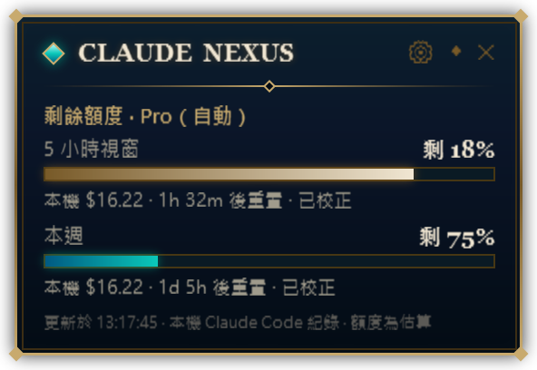
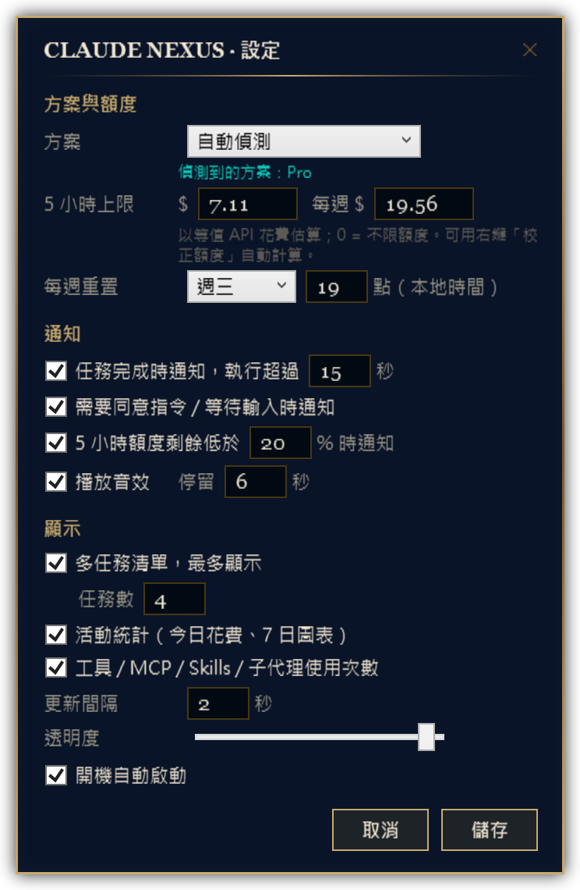

# Claude Nexus

> 永遠置頂的 Claude 用量監控小工具，帶點英雄聯盟海克斯科技風格。
> An always-on-top Windows widget for Claude Code usage — quota, cost, live tasks and notifications, styled after a MOBA HUD.

<p align="center">
  
  &nbsp;
  
</p>
<p align="center">
  <br>
  <sub>血條模式：生命 = 5 小時額度、魔力 = 每週額度、等級框 = 重置倒數</sub>
</p>

## 特色

- **即時花費**：讀取 Claude Code 的本機對話紀錄，依模型價格換算每個對話的「等值 API 花費」、tokens 與上下文大小，每 2 秒更新。
- **剩餘額度**：5 小時視窗與每週額度的進度條、重置倒數，接近上限時變金色 / 紅色。透過狀態列橋接直接讀取 Claude Code 收到的**官方用量**；收不到時，照抄一次官方用量頁就能校正並對齊官方重置時間。
- **自動偵測方案**：從 Claude Code 的帳號資訊判斷 Pro / Max 5x / Max 20x / Team / Enterprise / API，切換帳號或升級時自動套用對應額度。
- **多任務狀態**：同時列出所有執行中的 Claude Code 工作階段——執行中、等待確認、閒置——以及各自的花費。
- **正在使用的工具**：顯示每個任務當下呼叫的工具，例如 `MCP notion-search`、`Skill xlsx`、`子代理 Explore ▸ Bash`。
- **活動統計**：今日花費、請求數、對話數，以及工具 / MCP / Skills / 子代理的呼叫次數（滑鼠移上去可看排行），還有近 7 日花費長條圖。
- **小通知**：任務完成、需要你同意指令、額度偏低、方案切換時，在小工具旁跳出通知。
- **三種大小**：完整（296×560 左右）、精簡（296×204）、血條（203×52）。
- **零安裝相依**：只用 Windows 內建的 PowerShell 5.1 + WPF，不需要 Python、Node 或 .NET SDK。
- **完全離線**：只讀本機檔案，不送出任何網路請求。

<p>
  
  
</p>

## 需求

- Windows 10 / 11
- Windows PowerShell 5.1（系統內建）
- 有在使用 [Claude Code](https://claude.com/claude-code)（CLI、桌面版 Code 分頁或 IDE 外掛都可以）

## 安裝

```powershell
git clone https://github.com/<your-name>/ClaudeNexus.git
cd ClaudeNexus
powershell -NoProfile -File install.ps1 -StatusLine
```

安裝程式會：

1. 把程式複製到 `%LOCALAPPDATA%\ClaudeNexus`
2. 建立桌面與開始選單捷徑「Claude Nexus」
3. 加上 `-StatusLine` 時，在 `~/.claude/settings.json` 登記狀態列橋接，讓小工具讀到**官方用量**（見下方說明；已有自己的狀態列設定時不會覆蓋）
4. 立即啟動小工具（預設出現在螢幕右下角）

> 如果 PowerShell 回報「已停用指令碼執行」（Windows 預設的 `Restricted` 原則），請先允許執行本機指令碼，小工具之後的每次啟動也需要：
> `Set-ExecutionPolicy -Scope CurrentUser RemoteSigned`

解除安裝：

```powershell
powershell -NoProfile -File install.ps1 -Uninstall
```

不想安裝也可以直接執行：雙擊 `ClaudeNexus.vbs`（不會出現主控台視窗），或 `powershell -STA -File ClaudeNexus.ps1`。

## 使用方式

| 操作 | 效果 |
|---|---|
| 拖曳 | 移動位置（會記住） |
| `◇` | 切換 完整 → 精簡 → 血條 |
| 血條上雙擊 | 回到完整模式 |
| 血條上停留 | 顯示詳細數字 |
| `⚙` | 開啟設定視窗 |
| 右鍵 | 設定、校正額度、顯示模式、測試通知、開機自動啟動、結束 |

### 任務狀態

| 圖示 | 狀態 | 說明 |
|---|---|---|
| `●` 藍 | 執行中 | 下面一行顯示正在用的工具與經過時間 |
| `◆` 橘 | 等待確認 | Claude 在等你同意指令或回覆 |
| `○` 灰 | 閒置 | 工作階段還開著，但沒有在跑 |

狀態來自 Claude Code 寫在 `~/.claude/sessions/*.json` 的工作階段資訊；舊版 Claude Code 沒有這些檔案時，改用「最近幾分鐘內有沒有新紀錄」來判斷。



### 設定

點 `⚙` 或右鍵 →「設定…」：

- **方案與額度**：自動偵測或手動指定方案；各方案的 5 小時 / 每週上限；每週重置時間
- **通知**：任務完成（可設定最短執行秒數，避免短任務一直跳）、需要同意、額度低於 N%、音效、停留秒數
- **顯示**：多任務清單與最多顯示幾個、活動統計、工具統計、更新間隔、透明度、開機自動啟動

設定存在 `%APPDATA%\ClaudeNexus\config.json`，也可以直接編輯。

<br clear="right">

## 額度是怎麼算的？

小工具依序使用三種來源，畫面上會標示「官方」、「已校正」或「估算」：

### 1. 官方數字（建議）：狀態列橋接

Claude Code 每次更新狀態列時，會把官方的 5 小時 / 每週**已用 %** 與**重置時間**（`rate_limits`）交給狀態列指令。用 `install.ps1 -StatusLine` 安裝後，`statusline.ps1` 會把這份資料存到 `%APPDATA%\ClaudeNexus\ratelimits.json`，小工具直接顯示官方數字，兩次更新之間再把新增的本機花費換算上去；官方 % 累積上升時也會自動修正換算值。狀態列本身會顯示「模型 · 5h 72% · 週 23%」。

- 需要 Claude Code 會執行狀態列的介面，例如在終端機執行 `claude`。Claude 桌面版的 Code 分頁目前不一定會執行狀態列指令；沒有收到官方資料時，小工具會自動改用下面的方式。
- 已經有自己的狀態列時，安裝程式不會覆蓋；可以在自己的狀態列指令裡把 stdin 的 JSON 存成同一個檔案（格式見 `statusline.ps1`）。

### 2. 手動校正：基準點＋增量


右鍵 →「校正額度」，打開 Claude → 設定 → 用量，把畫面上的數字照抄進去：

- 5 小時額度：已使用 %、重置時間（例如 14:50）
- 每週額度：已使用 %、重置的星期與時間

小工具會記下「官方 %」和「當下的本機花費」當基準點，之後：

```
已用 % = 校正時的官方 % + (目前本機花費 − 校正時本機花費) ÷ 換算值 × 100
```

- **對齊官方重置時間**：5 小時視窗直接用你輸入的重置時間，不再從本機第一則訊息推算；視窗結束後基準點自動失效，改從下一則訊息重新起算。每週視窗也改用你輸入的重置時間。
- **其他裝置的用量不會再被算錯**：在 claude.ai 網頁、手機用掉的額度不在本機紀錄裡。舊版的校正（上限 = 花費 ÷ 官方 %）會把它們也算到本機頭上，造成上限偏低、越用越偏；現在它們只會包含在基準點裡。
- **自動學習換算值**：同一個 5 小時視窗內再校正一次（官方 % 至少差 5 點），會用兩次的差距算出「100% 額度 ≈ 多少等值花費」，存成目前方案的換算值。

### 3. 估算

沒有官方數字也沒校正過時，就單純以「本機花費 ÷ 換算值」估算，並從本機第一則訊息起算 5 小時。這種情況誤差最大（其他裝置的用量完全看不到），建議至少做一次手動校正。

<br clear="right">

### 換算值預設

「100% 額度 ≈ 多少等值 API 花費（USD）」：

| 方案 | 5 小時 | 每週 | 來源 |
|---|---|---|---|
| Pro | 26 | 118 | 實測（Claude Code + Opus 5.5） |
| Max 5x | 130 | 590 | Pro × 5 推算 |
| Max 20x | 520 | 2360 | Pro × 20 推算 |
| Team | 32.5 | 147.5 | Pro × 1.25 推算 |
| Team Premium | 162.5 | 737.5 | Team × 5 推算 |
| Enterprise / API | 不限（只顯示花費） | 不限 | |

### 為什麼還是會有誤差

- Anthropic 計算訂閱額度的方式未公開，不一定和 API 價格成比例。例如長對話中「快取讀取」佔花費的比例會從兩成多變成六成，換算值也會跟著漂移。
- 官方只顯示整數 %，短時間內的兩次校正誤差較大，所以至少要差 5 點才會更新換算值。
- 校正之後在其他裝置的用量依然看不到。

因此誤差只會來自「上次校正之後」的部分；**定期照抄一次官方數字**就能把誤差拉回 0。

### 方案偵測

讀取 `~/.claude.json` 的 `oauthAccount.organizationType` 與 `organizationRateLimitTier`（只取這兩個欄位，不讀 token）。檔案變動時會重新偵測，方案改變時會跳通知並套用該方案的上限。

### 價格表

花費依 [Anthropic 公開價格](https://docs.claude.com/en/docs/about-claude/pricing) 計算（每百萬 tokens），包含快取寫入（5 分鐘 ×1.25、1 小時 ×2）、快取讀取與 fast 模式（×2）。價格表在 `ClaudeNexus.ps1` 的 `$Pricing`，新模型推出時請更新。

## 讀取哪些檔案

| 路徑 | 用途 |
|---|---|
| `~/.claude/projects/**/*.jsonl` | 對話紀錄：tokens、模型、工具呼叫、對話標題 |
| `~/.claude/sessions/*.json` | 執行中的工作階段與狀態（執行中 / 等待確認 / 閒置） |
| `~/.claude.json` | 方案類型 |
| `%APPDATA%\ClaudeNexus\ratelimits.json` | 官方用量（由 `statusline.ps1` 寫入） |

有設定 `CLAUDE_CONFIG_DIR` 時會改讀該資料夾。小工具只讀檔、不連網；唯一會修改 Claude 設定的是 `install.ps1 -StatusLine`（登記狀態列，修改前會備份成 `settings.json.bak-claudenexus`，解除安裝時移除）。

## 已知限制

- 只看得到 **Claude Code** 的用量；在 claude.ai 網頁或手機 App 聊天的用量不會出現在本機紀錄，但仍會吃掉同一份額度——重新「校正額度」就會把它們併入基準點。
- 沒有官方數字時，剩餘額度是推算值，上次校正之後的部分會與官方數字有誤差。
- 從 v1 升級時，舊的校正結果因算法錯誤會被重設為預設值，請重新校正一次。
- Claude 桌面版內部使用的 `ccd_*` MCP 伺服器不計入 MCP 統計。
- 目前只支援 Windows。

## 開發

```powershell
# 只解析資料、輸出文字結果（不開視窗）
powershell -NoProfile -File ClaudeNexus.ps1 -Test

# 把目前畫面存成圖片（截圖都是這樣產生的）
powershell -NoProfile -STA -File ClaudeNexus.ps1 -Snapshot out.png
powershell -NoProfile -STA -File ClaudeNexus.ps1 -SnapshotSettings settings.png
```

整個程式只有一個 `ClaudeNexus.ps1`：前半段是資料解析與統計，後半段是 WPF 介面（XAML 直接寫在檔案裡）。檔案需以 **UTF-8 with BOM** 儲存，否則 Windows PowerShell 5.1 會把中文讀成亂碼。

歡迎發 Issue 和 PR。

## 免責聲明

本專案是非官方的社群工具，與 Anthropic 或 Riot Games 沒有任何關係。介面風格參考自 MOBA 遊戲的 HUD，未使用任何遊戲素材。「Claude」是 Anthropic 的商標。

## 授權

[MIT](LICENSE)
